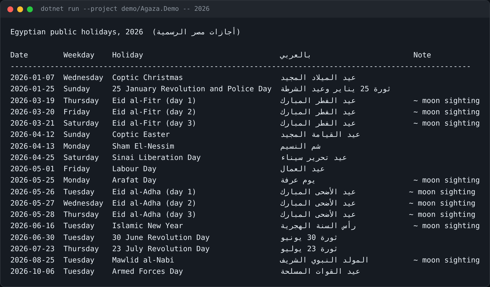
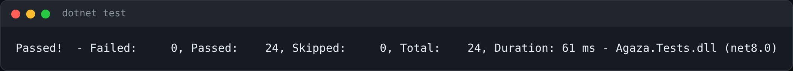

# agaza — أجازة

Egyptian public holidays for .NET: fixed national days, Coptic Easter and Sham El-Nessim by computus, and Islamic holidays from the tabular Hijri calendar. Every holiday carries English and Arabic names.

[](https://github.com/SENESO/agaza/actions/workflows/ci.yml)

## Quick start

```csharp
using Agaza;

foreach (var h in EgyptianHolidays.ForYear(2026))
    Console.WriteLine($"{h.Date}  {h.NameEn}  {h.NameAr}");

EgyptianHolidays.IsHoliday(new DateOnly(2026, 4, 13)); // true — Sham El-Nessim
var holiday = EgyptianHolidays.Find(DateOnly.FromDateTime(DateTime.Today));
```

## How the dates are computed

- **National days** — fixed Gregorian dates: 25 January, Sinai Liberation, Labour Day, 30 June, 23 July, Armed Forces Day.
- **Coptic Christmas** — January 7 (25 Kiahk in the Coptic calendar while the 13-day Julian shift holds).
- **Coptic Easter** — the Julian computus (Meeus), shifted 13 days into the Gregorian calendar. **Sham El-Nessim** is always the Monday after.
- **Islamic holidays** — Islamic New Year, Mawlid al-Nabi, Eid al-Fitr (3 days), Arafat Day, Eid al-Adha (3 days), converted from Hijri with .NET's `System.Globalization.HijriCalendar` (tabular civil scheme). A Gregorian year can hold the same Islamic holiday twice when the shorter Hijri year wraps around — 2008 had two Islamic New Years, and `ForYear(2008)` returns both.

## Guarantees and limits

- **Moon-sighting variance.** Islamic dates come from the arithmetic calendar, not the sky. Official observance follows the moon sighting and can shift a day or two; those entries are flagged `IsEstimate`.
- **1900-2099 only.** The Coptic computus assumes the 13-day Julian-to-Gregorian shift, which holds from 1900 through 2099. `ForYear` throws outside that range rather than returning wrong dates.
- **No substitution rules.** Egypt does not move holidays that fall on weekends, and this library does not invent shifts. Official decrees can add or move individual days; no library can predict those.
- **Zero dependencies, zero allocation per call beyond the result list.** Thread-safe and culture-independent: dates are `DateOnly`, names are plain strings.

## Demo

```
dotnet run --project demo/Agaza.Demo -- 2026
```



## Tests

```
dotnet test
```

Known dates are pinned against published calendars: Coptic Easter 2025-2027, Eid al-Fitr and Eid al-Adha 1446, Mawlid 1446, and the double Islamic New Year of 2008.



## License

MIT — see [LICENSE](LICENSE).
